<!-- markdownlint-disable MD033 MD041 MD013 -->
<a id="top"></a>

<div align="center">

<picture>
  
</picture>

# Ensuretech

**Group health insurance onboarding, as shared infrastructure.**<br/>
One validated, priced and audited record that brokers, employers, TPAs and insurers can all rely on.

<br/>


<br/>

[**Project site**](https://ensuretechinsurancebrokers.github.io/Ensuretech/) &nbsp;&middot;&nbsp;
[**Runbook**](https://ensuretechinsurancebrokers.github.io/Ensuretech/run.html) &nbsp;&middot;&nbsp;
[**Documentation**](#documentation) &nbsp;&middot;&nbsp;
[**Architecture**](#architecture) &nbsp;&middot;&nbsp;
[**Quick start**](#getting-started) &nbsp;&middot;&nbsp;
[**Security**](#security-model) &nbsp;&middot;&nbsp;
[**Software used**](#software-used-and-its-documentation)

</div>

<br/>

> [!NOTE]
> **Reading tip.** This page is built to be explored. Diagrams are interactive on GitHub (click one to zoom), sections marked with a triangle expand and collapse, and every heading has a stable link. Use the [reading paths](#choose-your-path) below to jump straight to what matters to you.

---

## At a glance

<table>
<tr>
<td align="center" width="20%"><h3>1.0 s</h3><sub>1000 valid rows, upload to endorsed<sup><a href="#user-content-fn-hw">1</a></sup></sub></td>
<td align="center" width="20%"><h3>11</h3><sub>services, one database each</sub></td>
<td align="center" width="20%"><h3>125</h3><sub>public API endpoints, every one with a screen</sub></td>
<td align="center" width="20%"><h3>106</h3><sub>columns in the legacy-format result sheet</sub></td>
<td align="center" width="20%"><h3>0</h3><sub>paid services needed to run and test locally</sub></td>
</tr>
</table>

```text
Legacy system, 1000 valid rows      3 min 52 s   ████████████████████████████████████████████████████████  232 s
Ensuretech,    1000 valid rows            ~1 s   ▏                                                          ~1 s
                                                 (different hardware: see the caveat in "Performance and verification")
```

---

## Contents

<details open>
<summary><strong>Expand or collapse the table of contents</strong></summary>

1. [Choose your path](#choose-your-path)
2. [Background, vision and mission](#background-vision-and-mission)
3. [Project status](#project-status)
4. [Documentation](#documentation)
5. [What the platform does](#what-the-platform-does)
6. [Architecture](#architecture)
7. [Services](#services)
8. [Data model and events](#data-model-and-events)
9. [Security model](#security-model)
10. [Access and operations policy](#access-and-operations-policy)
11. [Performance and verification](#performance-and-verification)
12. [Operations and observability](#operations-and-observability)
13. [Getting started](#getting-started)
14. [Configuration](#configuration)
15. [Testing](#testing)
16. [Troubleshooting](#troubleshooting)
17. [Repository layout](#repository-layout)
18. [Software used and its documentation](#software-used-and-its-documentation)
19. [Relationship to the legacy system](#relationship-to-the-legacy-system)
20. [Frequently asked questions](#frequently-asked-questions)
21. [Glossary](#glossary)
22. [Known limitations and roadmap](#known-limitations-and-roadmap)
23. [Contributing](#contributing)
24. [License](#license)

</details>

---

## Choose your path

Pick the description closest to you. Each row is a shortcut into the rest of this page and the documents it links to.

| If you are a | You probably want | Start here |
|:--|:--|:--|
| **Broker administrator** | Upload endorsements for many employers, watch them process, fix failures, manage deposits | [What the platform does](#what-the-platform-does), then sign in at the portal |
| **Employer HR user** | Add or remove your own people and see what went wrong in a file | [Ways to submit data](#ways-to-submit-data), [Result spreadsheet](#result-spreadsheet) |
| **TPA coordinator** | Exchange member ids and e-cards without an integration | [`docs/tpa-offline.md`](docs/tpa-offline.md) |
| **QA engineer** | Test every screen and API by hand, then automate | [Testing](#testing), [`docs/qa-handbook.md`](docs/qa-handbook.md) |
| **Operations or on-call** | Watch queues, kill a runaway job, find a slow query | [Operations and observability](#operations-and-observability), [Troubleshooting](#troubleshooting) |
| **Developer** | Run the stack, change a service, add an API | [Getting started](#getting-started), [Repository layout](#repository-layout), [Contributing](#contributing) |
| **Security reviewer** | How calls are signed, who can reach what, what is not covered yet | [Security model](#security-model), [`docs/request-signing.md`](docs/request-signing.md) |
| **Decision maker** | What exists, what is unproven, what it costs, what comes next | [Project status](#project-status), [`docs/aws-cost-estimate.md`](docs/aws-cost-estimate.md), [Roadmap](#known-limitations-and-roadmap) |

<p align="right"><sub><a href="#top">Back to top</a></sub></p>

---

## Background, vision and mission

### Background

The legacy system was a Laravel monolith. Large Excel uploads crashed it, imports had to be started by hand from the command line, a single malformed column could make a TPA reject an otherwise clean enrollment, and one internal user with too much trust and too few guardrails was able to degrade the production server. Every party in group insurance onboarding (brokers, TPAs, insurers, employers, HR teams) was fighting the same fragmentation: spreadsheets in different shapes, validation that happens late, and reconciliation done by hand.

Ensuretech treats that as a shared problem and builds the shared layer: data is validated once, as early as possible, then flows to everyone who needs it with an audit trail.

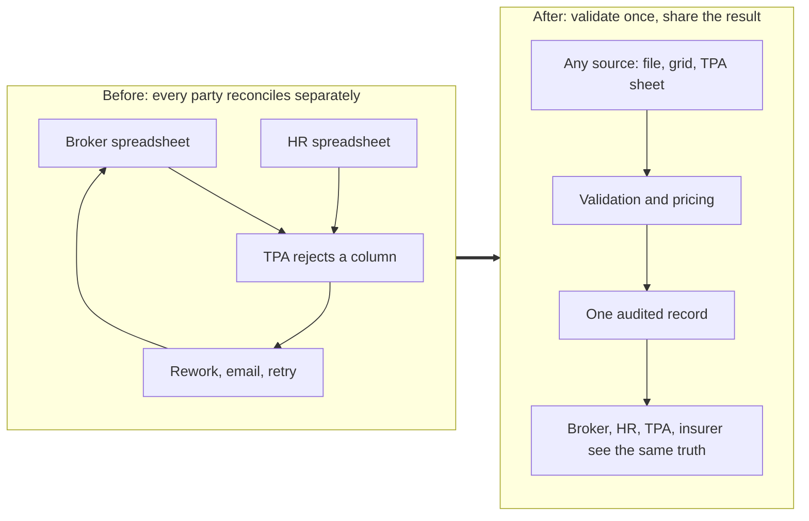

### Vision

Insurance onboarding becomes background infrastructure. Brokers, TPAs, insurers and employers work from a single operational record, and the friction of enrollment largely disappears.

### Mission

Build resilient, neutral, standards-driven onboarding infrastructure that removes spreadsheet chaos, validates data before it enters the ecosystem, and makes the shared operational record valuable enough that every participant spends less time reconciling and more time serving their customers.

### Who it serves

| Stakeholder | Problem addressed |
|:--|:--|
| **Brokers** | Onboarding effort, rejection loops, manual operations work |
| **Employers and HR teams** | Poor onboarding experience, spreadsheet handling, late validation feedback |
| **TPAs** | Malformed enrollment data, reconciliation effort, member id and e-card exchange |
| **Insurers** | Inconsistent ingestion, compliance gaps, limited audit visibility |
| **Operations** | Manual reconciliation, cascading failures, little visibility into running work |

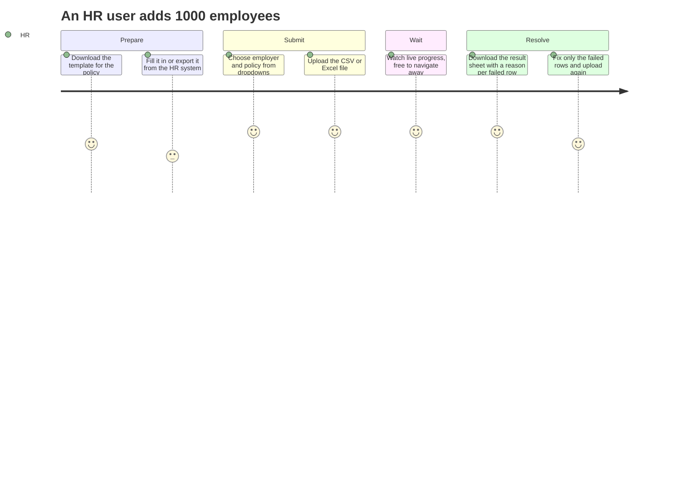

<p align="right"><sub><a href="#top">Back to top</a></sub></p>

---

## Project status

> [!IMPORTANT]
> This is a working platform that has been exercised end to end on a developer machine and by automated suites. It has **not** been through production hardening. The table separates what has been verified from what has not, so nobody has to guess.

| Area | State |
|:--|:--|
| Endorsement pipeline: CSV and Excel upload, validation, pricing, deposit check, roster write |  Automated tests and live runs |
| Result spreadsheet in the legacy `AddMemberError.xlsx` layout |  Add layout checked against a real legacy file; Remove and Update layouts are an assumption |
| Browser portal for brokers and HR, and a screen for every BFF API |  Read operations browser-checked; write operations not yet hand-tested |
| Request signing, tenant isolation, core lock, break-glass access |  Tested |
| Observability and operations tooling |  See [Operations and observability](#operations-and-observability) |
| Kafka-driven flows: events between services, notification mail, event-fed dashboards |  Implemented; never run against a real broker end to end |
| RabbitMQ as the Celery broker |  Supported; Redis is used locally |
| Read-service (MongoDB projections) and the assistant |  Suite needs MongoDB and has not been run here; answers are extractive unless a Claude API key is set, a path only tested against a stub |
| Transport encryption between services |  Not configured by default |
| Independent security assessment |  Not yet performed |
| Payment service |  Designed, not built |

<details>
<summary><strong>Checklist view</strong> (the same information as tick boxes)</summary>

- [x] Streaming CSV and Excel ingestion
- [x] Parallel validation, pricing and deposit check on isolated queues
- [x] Legacy-format result spreadsheet for Add
- [x] BFF with a screen for every API endpoint
- [x] Signed service calls and tenant isolation
- [x] Break-glass access with a full audit trail
- [x] Live request and SQL view, Flower, Spring Boot Admin, correlation ids
- [x] Production-style web tier (nginx and PHP-FPM) and connection pooling in the engine
- [ ] Hand testing of every write operation
- [ ] Kafka flows verified against a real broker
- [ ] RabbitMQ verified as the Celery broker
- [ ] Read-service suite run against MongoDB
- [ ] Remove and Update result sheets confirmed against real legacy files
- [ ] TLS between services; HTTPS at the edge
- [ ] Independent security assessment and dependency audit
- [ ] Measurement on production-sized hardware
- [ ] Payment service

</details>

Details and measured figures are in [`docs/load-test.md`](docs/load-test.md) and [`docs/qa-handbook.md`](docs/qa-handbook.md).

<p align="right"><sub><a href="#top">Back to top</a></sub></p>

---

## Documentation

Everything below lives in this repository and is also published on the project site at <https://ensuretechinsurancebrokers.github.io/Ensuretech/>.

<table>
<tr><th align="left">Document</th><th align="left">What you will find</th></tr>
<tr><td><a href="run.html"><code>run.html</code></a></td><td>The runbook: prerequisites, database setup, first run, a guided walkthrough, troubleshooting and the tooling index</td></tr>
<tr><td><a href="docs/qa-handbook.md"><code>docs/qa-handbook.md</code></a></td><td>How to test by hand and with automation, expected results, a symptom-to-tool debugging table</td></tr>
<tr><td><a href="docs/full-stack-local.md"><code>docs/full-stack-local.md</code></a></td><td>Running every component locally and the settings that matter</td></tr>
<tr><td><a href="docs/request-signing.md"><code>docs/request-signing.md</code></a></td><td>How the BFF signs each call and how a core service authenticates and authorizes it</td></tr>
<tr><td><a href="docs/core-lockdown.md"><code>docs/core-lockdown.md</code></a></td><td>The rules that keep core services unreachable except through the BFF</td></tr>
<tr><td><a href="docs/break-glass.md"><code>docs/break-glass.md</code></a></td><td>Emergency, audited access to act as one named user when the BFF is unavailable</td></tr>
<tr><td><a href="docs/observability.md"><code>docs/observability.md</code></a></td><td>Telescope, Silk, Flower, Spring Boot Admin, the live request and SQL view, Prometheus and Grafana; how to open each</td></tr>
<tr><td><a href="docs/load-test.md"><code>docs/load-test.md</code></a></td><td>Load-test method, measured results and the comparison with the legacy system</td></tr>
<tr><td><a href="docs/manual-test-8vcpu.md"><code>docs/manual-test-8vcpu.md</code></a></td><td>Settings and steps for a hand test on an 8 vCPU server</td></tr>
<tr><td><a href="docs/aws-cost-estimate.md"><code>docs/aws-cost-estimate.md</code></a></td><td>Planning estimate of monthly cloud cost by stage</td></tr>
<tr><td><a href="docs/runtime-dependencies.md"><code>docs/runtime-dependencies.md</code></a></td><td>Every external dependency, what it is for and whether it costs money</td></tr>
<tr><td><a href="docs/intake-routing.md"><code>docs/intake-routing.md</code></a></td><td>How an upload is routed between the grid and the file path</td></tr>
<tr><td><a href="docs/tpa-offline.md"><code>docs/tpa-offline.md</code></a></td><td>The offline TPA member id and e-card exchange</td></tr>
<tr><td><a href="docs/adr/"><code>docs/adr/</code></a></td><td>Architecture decision records</td></tr>
<tr><td><a href="docs/legacy/"><code>docs/legacy/</code></a></td><td>Reverse-engineered legacy sheet formats, raters and validation rules</td></tr>
<tr><td>Per-service <code>README.md</code></td><td>Details of each service under <a href="services/"><code>services/</code></a></td></tr>
</table>

<p align="right"><sub><a href="#top">Back to top</a></sub></p>

---

## What the platform does

### Endorsement lifecycle

An endorsement is a change to the insured population of a policy: adding, removing or updating members. One upload becomes one **job** that moves through a fixed state machine. Every transition is written to an append-only audit table, so the history of a job cannot be edited after the fact.

```mermaid
stateDiagram-v2
    direction LR
    [*] --> REQUEST_RAISED
    REQUEST_RAISED --> VALIDATION_QUEUED: file accepted
    VALIDATION_QUEUED --> VALIDATION_IN_PROGRESS
    VALIDATION_IN_PROGRESS --> VALIDATION_PASSED: no failed rows
    VALIDATION_IN_PROGRESS --> VALIDATION_PARTIAL: some rows failed
    VALIDATION_IN_PROGRESS --> VALIDATION_FAILED: every row failed
    VALIDATION_PARTIAL --> PREMIUM_CALC_QUEUED: continues with valid rows
    VALIDATION_PASSED --> PREMIUM_CALC_QUEUED
    PREMIUM_CALC_QUEUED --> PREMIUM_CALCULATED
    PREMIUM_CALCULATED --> CD_CHECK_INITIATED
    CD_CHECK_INITIATED --> CD_SUFFICIENT
    CD_CHECK_INITIATED --> CD_INSUFFICIENT: deposit too low
    CD_INSUFFICIENT --> CD_CHECK_INITIATED: retry after top-up
    CD_SUFFICIENT --> ENDORSEMENT_QUEUED
    ENDORSEMENT_QUEUED --> ENDORSEMENT_IN_PROGRESS
    ENDORSEMENT_IN_PROGRESS --> ENDORSED
    VALIDATION_FAILED --> [*]
    ENDORSED --> [*]
```

Blocked and failed states (insufficient deposit, a pricing failure, a billing outage) are recoverable with a retry once the cause is fixed.

### The pipeline, stage by stage

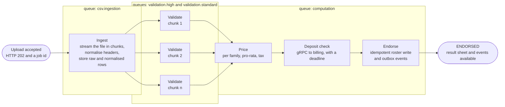

| Stage | Work done | Runs on |
|:--|:--|:--|
| **Ingest** | Stream the file in chunks, match headers by synonym and similarity, store raw and normalised rows | Celery worker group `ingest` |
| **Validate** | Per-row rules (names, dates, relations, family construct, duplicates, policy rules), one task per chunk, in parallel | Worker group `validation` |
| **Price** | Per-family premium from the policy's rate card, pro-rata by effective date, tax | Worker group `computation` |
| **Deposit check** | Ask billing-service whether the policy's deposit covers the premium (gRPC, with a deadline) | Worker group `computation` |
| **Endorse** | Write roster members idempotently and emit events through a transactional outbox | Worker group `computation` |

A job where some rows fail and others pass **continues with the rows that passed**; the failures stay on the job. A job where every row fails stops at `VALIDATION_FAILED`. Setting `PARTIAL_AUTO_CONTINUE=false` holds a partly failed job until a person confirms it.

### Ways to submit data

<details open>
<summary><strong>File upload</strong>: CSV or Excel (.xlsx)</summary>

Columns are matched by name and similarity, so files exported from other HR systems can be read; mappings can be saved and reused. Files stream through the pipeline in chunks, so memory use does not grow with file size. Excel files are read in read-only streaming mode, and the compressed size is bounded so a crafted file cannot exhaust memory.

</details>

<details>
<summary><strong>Grid</strong>: for small changes</summary>

An on-screen grid that validates every row as it is typed, up to a configurable number of employees. Above that limit the portal offers a template spreadsheet generated for the policy. The routing rule is described in [`docs/intake-routing.md`](docs/intake-routing.md).

</details>

<details>
<summary><strong>Offline TPA exchange</strong>: for TPAs without an integration</summary>

Download the list of members waiting for ids, send it to the TPA, upload the TPA's sheet; ids and e-card links are matched back to members. See [`docs/tpa-offline.md`](docs/tpa-offline.md).

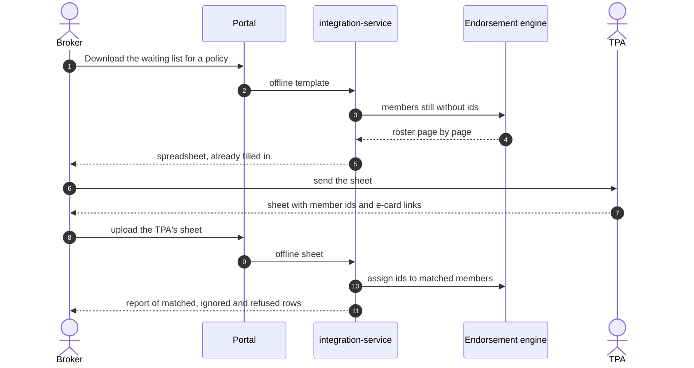

</details>

### Result spreadsheet

After an upload, the page offers **Download as a spreadsheet**. The file follows the legacy format: one sheet named `Worksheet`, the legacy column layout (106 columns for Add), one row for **every** uploaded row in upload order, and two final columns, `Status` and `Reason`.

| Row outcome | `Status` | `Reason` |
|:--|:--|:--|
| Endorsed | `Member added successfully.` | empty |
| Failed validation | `Failed to add.` | what is wrong, for example `dob: unreadable date '99/99/9999'` |
| Passed, not endorsed yet | `Not yet added.` | the state of the upload, so it is never mistaken for finished work |

Values that begin with `=`, `+`, `-` or `@` are written as text so a hostile cell cannot execute as a formula.

### Multiple employers and policies

Brokers work across many employers and policies. The upload and add/remove forms offer an **Employer** dropdown that narrows the **Policy** dropdown. Employer users see only their own employer. Isolation between tenants is enforced by the core services, not the portal (see [Security model](#security-model)).

### A screen for every API

The BFF publishes 125 endpoints. Each one is served either by a purpose-built page or by a card in **Settings and tools**, whose form is generated from the API's own field rules. The rule is enforced by a test, so an endpoint cannot be added without a screen.

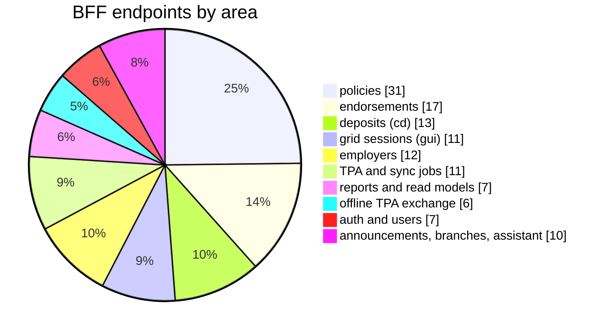

<p align="right"><sub><a href="#top">Back to top</a></sub></p>

---

## Architecture

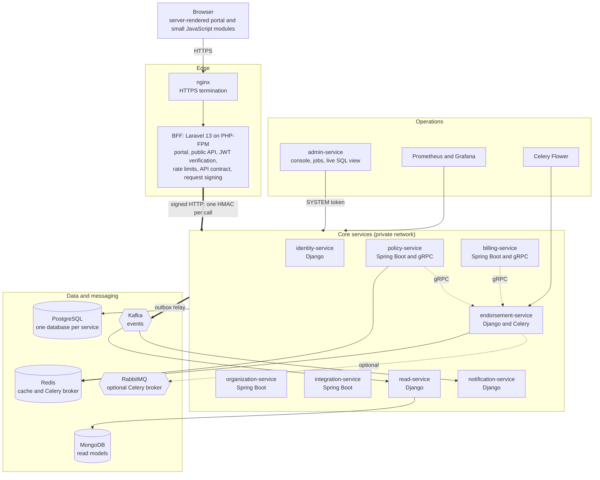

### Design principles

<table>
<tr>
<td width="33%" valign="top">

**One public entry point**<br/>
Only the BFF is reachable by users. Core services refuse any request that is not signed by the BFF or made with a service account's super credentials.

</td>
<td width="33%" valign="top">

**Workload isolation**<br/>
The engine runs three Celery worker groups on separate queues with their own concurrency, so a very large upload cannot starve other work.

</td>
<td width="33%" valign="top">

**Database per service**<br/>
Each service owns its PostgreSQL database. Services share contracts in `shared/contracts`, never tables.

</td>
</tr>
<tr>
<td valign="top">

**Events through an outbox**<br/>
State changes are written to an outbox table in the same transaction and relayed to Kafka, so an event is never lost and never published for a change that rolled back.

</td>
<td valign="top">

**Idempotent writes**<br/>
Jobs, applied rows and ledger entries carry keys, so a redelivered task or a repeated request does not apply twice.

</td>
<td valign="top">

**Graceful degradation**<br/>
Calls to other services have deadlines. A failure parks a job in a recoverable state instead of losing it.

</td>
</tr>
</table>

### One request, end to end

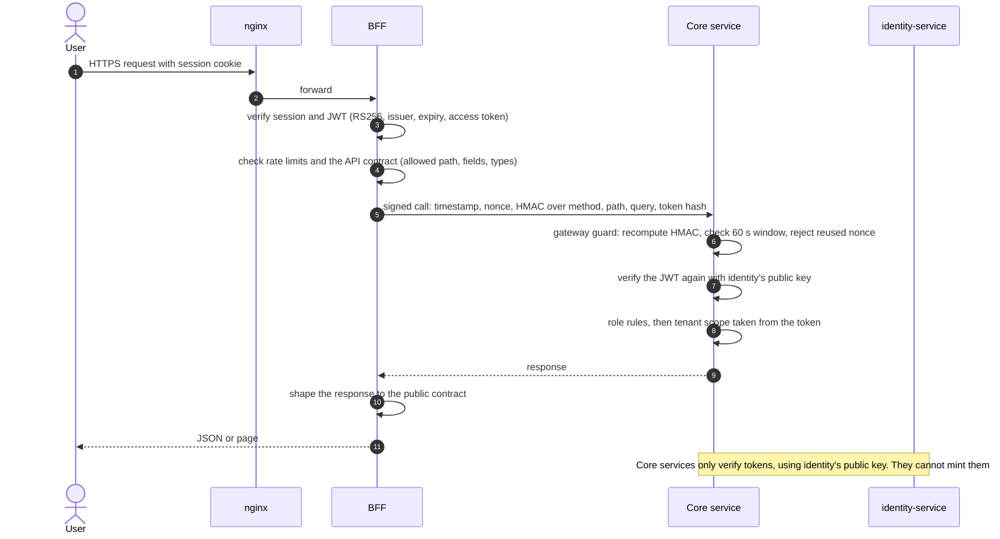

<p align="right"><sub><a href="#top">Back to top</a></sub></p>

---

## Services

| Service | Technology | Port | Responsibility | Data |
|:--|:--|:--:|:--|:--|
| `bff` | Laravel 13, PHP 8.3, nginx and PHP-FPM | 8090 | Portal and public API; verifies tokens, applies rate limits, enforces the API contract, shapes responses, signs calls to core services | Stateless (sessions on disk or Redis) |
| `identity-service` | Django 6.1, Django REST framework, SimpleJWT | 8000 | Users, roles, tenant scoping, JWT issuance (RS256), service accounts and the super-credential token, break-glass grants | PostgreSQL |
| `organization-service` | Spring Boot 4.1, Java 21 | 8081 | Employers, parent and child employers, employer options, branches, announcements | PostgreSQL |
| `policy-service` | Spring Boot 4.1, gRPC | 8082, gRPC 9090 | Policies, rate cards, family construct and relation rules, contributions, rounding, mid-term rules, enrolment windows, premium quotes | PostgreSQL, Redis cache |
| `endorsement-service` | Django 6.1, Celery 5.6, uvicorn | 8083 | The engine: intake, validation, pricing, deposit check, roster, result sheet, live progress over server-sent events | PostgreSQL, Redis or RabbitMQ |
| `billing-service` | Spring Boot 4.1, gRPC | 8084, gRPC 9091 | Policy deposit (CD) accounts, ledger, statements, thresholds, top-up requests, pools | PostgreSQL |
| `integration-service` | Spring Boot 4.1, Resilience4j | 8085 | TPA connections, sync jobs, reconciliation, offline member id and e-card exchange, job controls | PostgreSQL |
| `sheet-generator-service` | Spring Boot 4.1, Apache POI | 8086 | Policy-driven sample and test sheets (Excel and CSV) and a standalone HTML generator | PostgreSQL |
| `read-service` | Django, MongoDB | 8087 | Read models built from events, dashboards, reports, knowledge documents and the assistant | MongoDB |
| `notification-service` | Django | n/a | Consumes events and sends email | PostgreSQL |
| `admin-service` | Spring Boot 4.1, Spring Boot Admin | 8100 | Operations console, background job controls, live request and SQL view | none |

<details>
<summary><strong>Local infrastructure</strong> (what the Compose files start)</summary>

[`docker-compose.infra.yml`](docker-compose.infra.yml)

| Component | Image | Local port |
|:--|:--|:--|
| PostgreSQL | `postgres:16` | 5432 |
| Redis | `redis:7` | 6379 |
| MongoDB | `mongo:7` | 27017 |
| RabbitMQ with management UI | `rabbitmq:3.13-management` | 5672, 15672 |
| Kafka (KRaft) | `apache/kafka:3.9.1` | 9092 |
| Mailpit | `axllent/mailpit` | SMTP 1025, inbox 8025 |

[`docker-compose.observability.yml`](docker-compose.observability.yml): Prometheus `v2.55.1`, Grafana OSS `11.3.0`, Kafka UI `v0.7.2`. Every port is bound to `127.0.0.1`.

</details>

<p align="right"><sub><a href="#top">Back to top</a></sub></p>

---

## Data model and events

### The engine's core tables

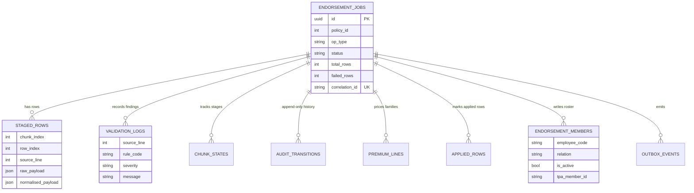

### Events and contracts

Services share definitions, never tables. Contracts live under [`shared/contracts/`](shared/contracts/).

| Contract | Kind | Purpose |
|:--|:--|:--|
| `endorsement-state-changed` | Kafka event | A job moved to a new state |
| `endorsement-applied` | Kafka event | An endorsement wrote members; carries premium and tax as decimal strings, never floats |
| `policy-approved` | Kafka event | A policy became usable; billing opens its deposit account |
| `cd-balance-updated` | Kafka event | A deposit changed; feeds dashboards and low-balance alerts |
| `tpa-sync-completed`, `tpa-sync-failed` | Kafka events | Outcomes of sending members to a TPA |
| `policy_validation.proto` | gRPC | The engine asks policy-service for a policy's facts and rules |
| `billing_cd.proto` | gRPC | The engine asks billing-service whether a deposit covers a premium |

A test compares real events with the shared samples, so a field cannot change name or type unnoticed.

<p align="right"><sub><a href="#top">Back to top</a></sub></p>

---

## Security model

Full detail: [`docs/request-signing.md`](docs/request-signing.md) and [`docs/core-lockdown.md`](docs/core-lockdown.md).

### Two separate proofs on every call

| Question | Proof | Checked by |
|:--|:--|:--|
| Did this call come through the BFF? | A **signature**: HMAC-SHA256 over a version tag, timestamp, one-time nonce, method, exact path, query string and a hash of the user's token, using a secret shared by the BFF and the core services | The gateway guard in each core service, before anything is parsed or any database is touched |
| Who is the user and what may they do? | The user's **access token**, an RS256 JWT issued by identity-service | The BFF first, then again by every core service using identity's public key |

```text
X-Gateway-Timestamp  1791625000
X-Gateway-Nonce      9f2c41d07a6be38f1c55d2a0
X-Gateway-Signature  HMAC-SHA256( secret,
                       "v1" LF timestamp LF nonce LF METHOD LF path LF query LF sha256(Authorization) )
```

A signature is valid for one method, path, query and token, for 60 seconds, once. The secret never travels. A request with neither a valid signature nor a valid super-credential token receives an empty `403`.

### Authorization in the core services

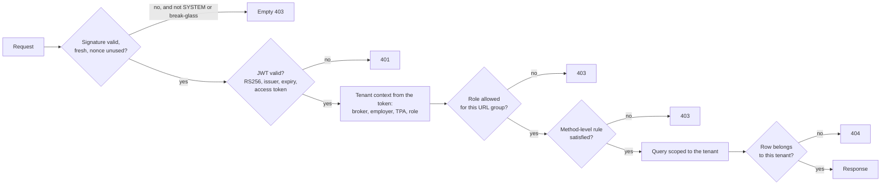

### Privileged access

| Mechanism | Purpose |
|:--|:--|
| **SYSTEM token** | A short-lived token obtained with a service account's client id and a 384-bit secret stored only as a hash. Used by services and operators for internal and operational endpoints. It has no tenant, so it cannot act as a broker or employer. |
| **Break-glass** | When the BFF is unavailable, an operator holding both super credentials and the break-glass password can obtain a 15-minute token to act as one named, existing user. Every attempt is recorded, the token carries the operator and reason, the live request view flags its use, and it has no portal or frontend interface. |
| **Job-killer password** | A separate hashed password required to stop or requeue background sync jobs. |
| **Honeypot routes** | Bait routes in the BFF that look like administrative endpoints, answer like any unknown path, and raise a silent alert when touched. |

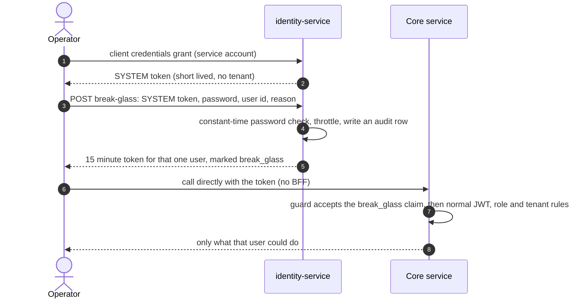

> [!TIP]
> Break-glass is for Postman and `curl`, by design. It has no screen. See [`docs/break-glass.md`](docs/break-glass.md) and `scripts/breakglass.sh`.

### Web security

The portal escapes all output, sends a nonce-based Content-Security-Policy and standard security headers, applies CSRF protection to every state-changing request, and stores tokens server-side so they never reach browser scripts. File downloads are checked against the content types the API contract allows. Uploaded values that look like formulas are neutralised in generated spreadsheets.

### What is not covered yet

> [!WARNING]
> - The signature proves **origin and integrity**, not secrecy. Traffic between the BFF and core services is plain HTTP unless TLS or mutual TLS is added. Keep it on loopback or a private network, and terminate HTTPS for browsers at nginx.
> - gRPC listeners bind to all interfaces by default and accept only service accounts. Place them behind a firewall.
> - No independent penetration test or dependency audit has been performed. Before real data: OWASP ZAP against the BFF, a dependency vulnerability scan, and TLS everywhere.

<p align="right"><sub><a href="#top">Back to top</a></sub></p>

---

## Access and operations policy

This section records the architectural decisions on privileged access, the BFF's role as a contract boundary, and the planned payment service.

<details open>
<summary><strong>Source ownership is separate from production access</strong></summary>

Source-code access, infrastructure access, database access and application-level access are separate privileges. A small, highly trusted group owns the core backend source and makes permanent fixes. A wider operations group may need production access to diagnose and mitigate incidents without any source access. This limits the damage if one account or credential is compromised.

</details>

<details>
<summary><strong>Network boundary and manual access</strong></summary>

Core services are private and not publicly routable. Normal traffic is client, then BFF, then core service. Privileged humans who need direct access to internal APIs enter through the corporate VPN; the VPN provides network reach only, and individual authentication and narrow authorization still apply.

Postman is the supported manual client, but it is **not** a security control: a request from `curl`, Postman or a script is the same HTTP request. The controls are the private network, VPN, individual identity, authentication, authorization and narrow endpoint permissions.

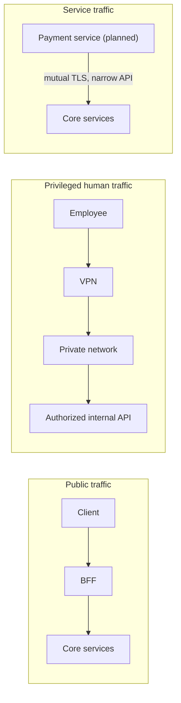

</details>

<details>
<summary><strong>The BFF as the public contract boundary</strong></summary>

The BFF owns the public representation of backend data. It validates and sanitises input, removes internal fields, normalises values and composes responses. Every endpoint, field and path parameter the portal can use is declared in the contract files (`services/bff/config/contract.php` and `services/bff/contract/`); anything not declared is refused.

Controlled response transformations let a defect in a core service be contained at the boundary while a permanent fix is prepared. They are limited to **representation**:

```diff
+ filtering, renaming, normalising enum values, composing responses, safe emergency masking
- recalculating a premium, deciding authorization, changing financial state
```

Business calculations, domain invariants, authorization decisions and financial state stay in the core services. A temporary mitigation must record an identifier, the endpoint, the reason, an owner, the date, the removal condition and a review date, so the BFF does not accumulate undocumented business logic.

</details>

<details>
<summary><strong>Production debugging as a distinct privilege</strong></summary>

An operations role sits between ordinary application access and source ownership.

| It can | It cannot |
|:--|:--|
| Inspect requests, sanitised responses, job status, queues and validation failures | Modify core source code |
| Retry safe and idempotent jobs, reprocess approved operations | Run arbitrary SQL |
| Apply approved BFF mitigations, disable a broken client capability | Deploy arbitrary code or read backend secrets |
| Inspect operational diagnostics | Change authentication rules, core business logic, or manipulate production data without limit |

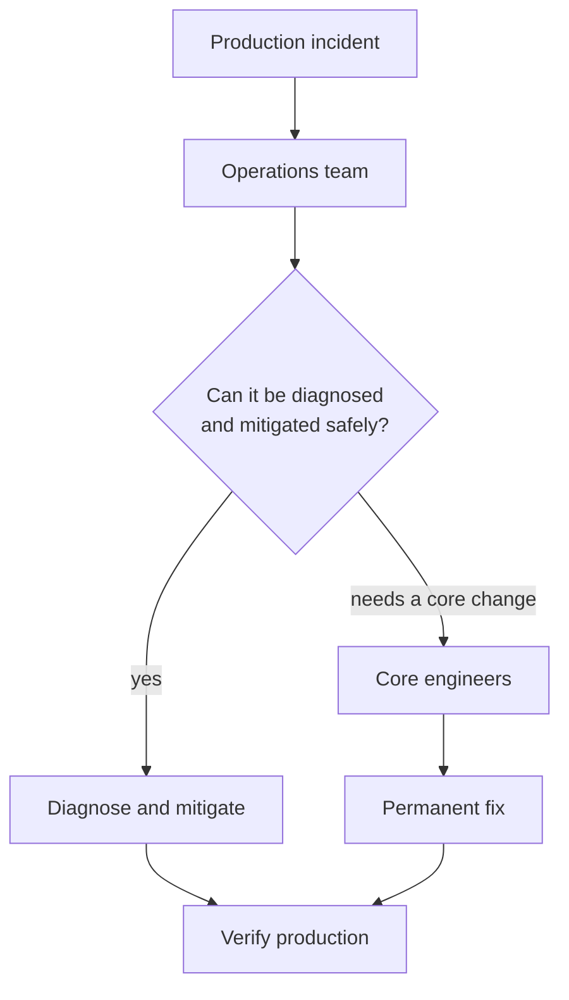

</details>

<details>
<summary><strong>Vulnerability response</strong></summary>

Findings from a bug bounty or red team go to the core owner, who decides whether the BFF can safely contain the issue. If it can, a mitigation is deployed at the BFF immediately and the permanent fix follows, after which the mitigation is removed. If it cannot, the core fix proceeds directly.

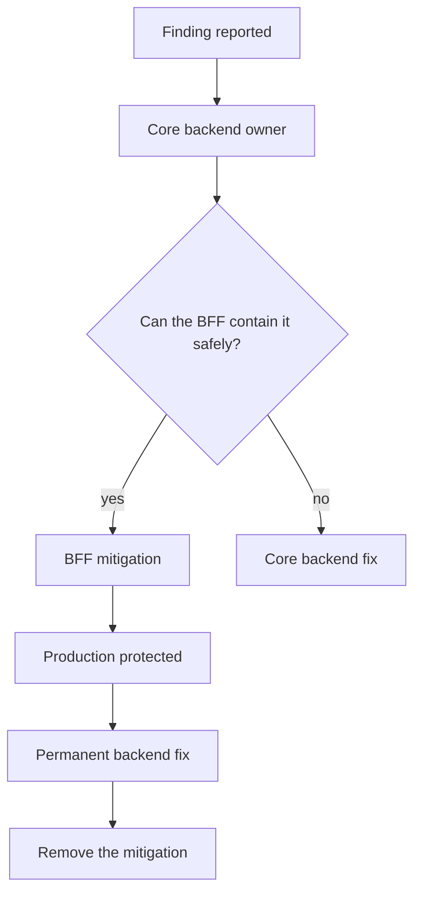

</details>

<details>
<summary><strong>Payment service (planned)</strong></summary>

The payment service will be an intentional exception to the normal path: an internal service-to-service workflow that talks to the core directly instead of through the BFF. The exception does not bypass security. It requires private networking, strong service identity with mutual TLS or equivalent, explicit authorization, an endpoint allowlist, a payment-specific contract, idempotency and validation.

```http
POST /internal/payments/authorize
POST /internal/payments/capture
POST /internal/payments/refund
POST /internal/payments/reconcile
GET  /internal/payments/{payment_id}
```

It receives a narrow set of capabilities, not general backend access, and it does not depend on the client-facing response shaping done by the BFF. **This service is not implemented yet.**

</details>

<p align="right"><sub><a href="#top">Back to top</a></sub></p>

---

## Performance and verification

Method, raw results and caveats are in [`docs/load-test.md`](docs/load-test.md).

> [!NOTE]
> Every figure below was measured on a 4 vCPU, 15 GiB build machine running **everything at once** (databases, services, workers and the load generator), with the BFF on nginx and PHP-FPM. Treat the numbers as a floor for the software on that hardware, not as a comparison with a production server of a different size.[^hw]

### Measured results

| Case (1000 rows unless stated) | Result |
|:--|:--|
| All rows valid | about **1.0 s** from upload to `ENDORSED` |
| 996 valid and 4 invalid | about **1.0 to 1.3 s** to `ENDORSED`, with the 4 failures listed |
| All rows invalid | about **0.7 s** to `VALIDATION_FAILED`; the result spreadsheet downloads in about 0.3 s |
| Ten 1000-row uploads at once | all complete in about **6 s** |
| 10,000 rows and 25,000 rows | about **7.4 s** and **19 s** |
| BFF reads, 20 concurrent users | about **170 to 225** requests per second, median 35 to 61 ms |

```text
Time to process 1000 valid rows (smaller is better)

  legacy, production hardware   ████████████████████████████████████████  232 s
  Ensuretech, build machine     ▏                                          ~1 s
```

Against the legacy system's recorded 3 minutes 52 seconds for the same size, the measured ratio is

$$
\frac{232\ \text{s}}{\approx 1.0\ \text{to}\ 1.25\ \text{s}} \;\approx\; 185\times \text{ to } 230\times
$$

on different hardware, so read it as "roughly two orders of magnitude", not as a precise figure.

<details>
<summary><strong>What made the BFF faster</strong>: from about 50 to about 220 requests per second</summary>

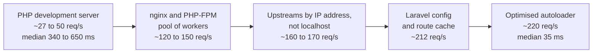

Also found and fixed under load: a database connection leak in the engine (about one in eight list calls failed once PostgreSQL's connection slots ran out), and an empty-download bug when development packages were installed. Both are described in [`docs/load-test.md`](docs/load-test.md).

</details>

<details>
<summary><strong>Timeline of one 1000-row upload</strong> (first-seen times in seconds)</summary>

```mermaid
gantt
    title One 1000-row upload, measured stage by stage
    dateFormat x
    axisFormat %L ms
    section Accept
    Upload accepted and job created   :done, a1, 0, 180
    section Validate
    Chunks validated in parallel      :done, a2, 180, 470
    section Price
    Premium per family                :done, a3, 470, 770
    section Deposit and write
    Deposit check and roster write    :done, a4, 770, 1070
```

</details>

<details>
<summary><strong>Reproduce the measurements</strong></summary>

```bash
scripts/dev-up.sh --bench --no-kafka --with-sheet --skip bff   # services without debugging overhead
scripts/bff-fpm.sh --bench                                      # the BFF on nginx and PHP-FPM
python3 qa/load/loadtest.py endorse --rows 1000 --uploads 5     # five 1000-row uploads, timed
python3 qa/load/loadtest.py reads --users 20 --seconds 20       # read throughput
```

The portal also has a **QA timing** page (`/app/qa/timing`, only when `BFF_QA_TOOLS=true`) with buttons that build a sheet, upload it and time each step. A real-browser driver is in `qa/qa-timing-page.js`.

</details>

[^hw]: Hardware matters. The measurement machine has 4 vCPU at about 2.1 GHz with no hyper-threading and runs the load generator on the same cores. The legacy figure was recorded on an 8 vCPU server at 2.8 GHz that also hosts other workloads. A fair comparison needs the same hardware and the same stopwatch; the protocol is in [`docs/load-test.md`](docs/load-test.md#comparing-fairly-with-legacy).

<p align="right"><sub><a href="#top">Back to top</a></sub></p>

---

## Operations and observability

Each tool binds to `127.0.0.1`. Reach it from your own machine, over an SSH tunnel for a server, and never expose these ports publicly. Instructions and logins are in [`docs/observability.md`](docs/observability.md).

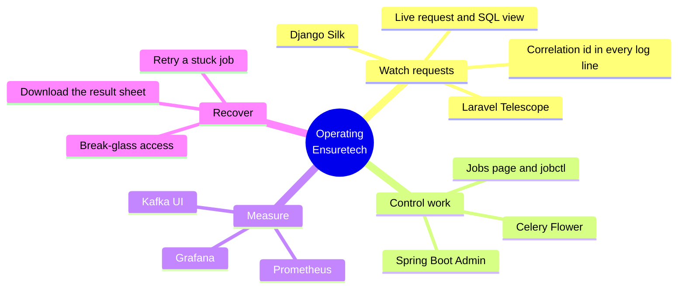

| Tool | Shows or controls | Applies to |
|:--|:--|:--|
| **Live requests and SQL** (operations console, `/queries.html`) | Each request as it happens: user, role, tenant, controller method, every SQL statement with timing, repeated-statement warnings, IST timestamps, free-text filtering | Spring services |
| **Spring Boot Admin** (operations console) | Health, metrics, threads, log levels, scheduled jobs | Spring services |
| **Jobs page** and `scripts/jobctl.sh` | List, kill and requeue background sync jobs, protected by the job-killer password | integration-service |
| **Celery Flower** | Workers, queues, every task and its retries; revoke tasks and manage workers | Endorsement engine |
| **Django Silk** and Debug Toolbar | Every request with its SQL and timings (development only, requires `DEBUG` and `DEV_TOOLS`) | Django services |
| **Laravel Telescope** and Ray | Requests, outgoing calls, exceptions, logs (local environment only) | BFF |
| **Prometheus, Grafana, Kafka UI** | Metrics, dashboards, topics (`scripts/observability-up.sh`) | All |
| **Correlation id** | One id on every log line of every service; trace a request with `grep -h <id> .dev/logs/*.log` | All |
| **Mailpit** | Catches outgoing mail locally | notification-service |

> [!TIP]
> Send your own correlation id to follow one request across every service:
> `curl -H "X-Correlation-Id: my-test-001" ...` then `grep -h my-test-001 .dev/logs/*.log | sort`.

<details>
<summary><strong>Reaching these tools on a server</strong></summary>

```bash
ssh -L 8100:127.0.0.1:8100 -L 5555:127.0.0.1:5555 -L 8083:127.0.0.1:8083 you@your-server
# then open http://127.0.0.1:8100 (console) and http://127.0.0.1:5555 (Flower) on your own machine
```

</details>

<p align="right"><sub><a href="#top">Back to top</a></sub></p>

---

## Getting started

### Prerequisites

- [x] Linux or macOS with bash and tmux (Windows is not verified)
- [x] Java 21 and Maven
- [x] Python 3.13 with `venv`
- [x] PHP 8.3 with Composer (plus `php8.3-fpm` and `nginx` for the production-style web tier)
- [x] PostgreSQL 16 and Redis 7. Kafka, RabbitMQ, MongoDB and Mailpit are optional
- [ ] Node.js 20 or later, only for the browser checks

### First run

The complete, checked procedure (creating the databases, generating keys, the shared secret, seeding sample data) is in [`run.html`](run.html). In outline:

```bash
git clone https://github.com/EnsuretechInsuranceBrokers/Ensuretech.git
cd Ensuretech

# infrastructure: PostgreSQL and Redis are required, the rest are optional
docker compose -f docker-compose.infra.yml up -d

# start everything that can run, one tmux window per process
scripts/dev-up.sh --no-kafka --with-sheet

# stop it
scripts/dev-down.sh
```

<details>
<summary><strong>Every <code>dev-up.sh</code> flag</strong></summary>

| Flag | Effect |
|:--|:--|
| `--check` | Verify the machine, infrastructure and databases; start nothing |
| `--no-kafka` | Run without Kafka: the portal works, event-fed dashboards and hand-offs do not |
| `--with-sheet` | Also start the sheet generator |
| `--with-mail` | Also start the notification consumer and sender |
| `--bench` | No debugging overhead and raised BFF rate limits, for load tests |
| `--devtools` | Django Silk and Debug Toolbar |
| `--ray` | Send debug output to the Ray desktop app |
| `--eager` | Run Celery tasks inline in the engine, with no workers or Flower |
| `--no-admin`, `--no-flower`, `--no-telescope` | Leave that tool out |
| `--skip a,b` or `--only a,b` | Choose components by name |
| `--rebuild` | Rebuild the Spring jars even if they exist |
| `--no-attach` | Start and return, without attaching to tmux |

</details>

### Where things listen

| Address | What |
|:--|:--|
| <http://localhost:8090/login> | Portal. Sample users are listed in `run.html` |
| <http://127.0.0.1:8100> | Operations console |
| <http://127.0.0.1:5555> | Celery Flower |
| <http://localhost:8025> | Mailpit inbox |

### Run it like production

```bash
scripts/bff-fpm.sh            # the BFF behind nginx and PHP-FPM, with Laravel's config and route cache
```

> [!NOTE]
> Everything needed for local development and testing is open-source software on your own machine ([`docs/runtime-dependencies.md`](docs/runtime-dependencies.md)). Two features need something extra: Kafka-driven flows need a Kafka broker, and the assistant's generative answers need an Anthropic API key. Everything else runs without them.

<p align="right"><sub><a href="#top">Back to top</a></sub></p>

---

## Configuration

Local settings live in [`local.env`](local.env), sourced by every launcher. It holds development-only values and is safe to commit. Values that must not be committed go in an untracked `local.env.private` at the repository root, which `local.env` loads if it exists and which is listed in `.gitignore`.

| Variable | Used by | Meaning |
|:--|:--|:--|
| `GATEWAY_SECRET` and `BFF_GATEWAY_SECRET` | Core services and BFF | The shared signing secret, 32 or more characters; services refuse to start without it |
| `JWT_PUBLIC_KEY_LOCATION`, `BFF_JWT_PUBLIC_KEY_PATH` | Core services and BFF | Identity's public key for verifying tokens |
| `BREAK_GLASS_PASSWORD` | identity-service | Enables break-glass access when 16 or more characters. Keep in `local.env.private` |
| `QUERYLOG_ENABLED` | Spring services | Turns the live request and SQL recording on or off. Leave off outside development |
| `BFF_QA_TOOLS` | BFF | Enables QA-only pages and routes. Off by default |
| `PIPELINE_AUTO_CONTINUE`, `PARTIAL_AUTO_CONTINUE` | Engine | Whether passed and partly failed uploads continue by themselves |
| `DB_POOL`, `DB_POOL_MAX` | Engine | Database connection pool for the ASGI process |
| `CELERY_BROKER_URL` | Engine | Redis or RabbitMQ |
| `ADMIN_UI_USER`, `ADMIN_UI_PASSWORD`, `FLOWER_BASIC_AUTH`, `METRICS_TOKEN` | Operations tools | Logins and tokens for the console, Flower and metrics scraping |

> [!CAUTION]
> Change every development value before any shared or deployed use. `local.env` contains deliberately weak, publicly known development credentials.

<p align="right"><sub><a href="#top">Back to top</a></sub></p>

---

## Testing

| Suite | Location | Command | Approximate count |
|:--|:--|:--|--:|
| BFF: API contract, portal, signing, a screen for every API | `services/bff/tests` | `php artisan test` | 108 |
| Identity | `services/identity-service/tests` | `pytest -q` | 62 |
| Endorsement engine | `services/endorsement-service/tests` | `DATABASE_URL=... pytest -q` | 342 |
| Notification | `services/notification-service/tests` | `pytest -q` | 42 |
| Read-service | `services/read-service/tests` | `TEST_MONGO_URI=... pytest -q` (needs MongoDB) | not run here |
| Spring services | `services/*/src/test` | `DATABASE_URL=jdbc:... mvn test` | 320 |
| Whole stack through its public doors | `qa/smoke.sh` | with the stack running | 60 |
| Browser checks | `qa/portal-smoke.js`, `qa/portal-manage-smoke.js` | with the stack and Playwright | every portal area |

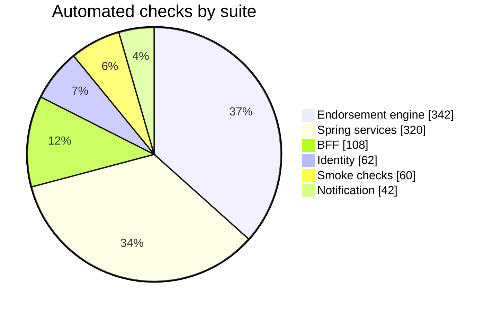

> [!WARNING]
> The test suites **truncate tables**. Point `DATABASE_URL` at a scratch database, never at a development database you want to keep.

Rules enforced by tests, not by convention:

- [x] Every endpoint in the BFF contract has a portal page or a "Settings and tools" card.
- [x] Real events match the shared sample contracts field for field and type for type.
- [x] A request without a valid signature is refused, and a signature cannot be reused, replayed, or moved to another path.
- [x] A downloaded file is a real file, not an empty body.
- [x] The error sheet's header row matches the legacy layout.

<p align="right"><sub><a href="#top">Back to top</a></sub></p>

---

## Troubleshooting

<details>
<summary><strong>A direct call to a service port returns 403</strong></summary>

That is the lock working. Core services answer only BFF-signed requests or SYSTEM tokens. Go through the BFF, or use a SYSTEM or [break-glass](docs/break-glass.md) token.

</details>

<details>
<summary><strong>An upload sits at <code>CD_PARTIAL_SUFFICIENT</code> or <code>CD_INSUFFICIENT</code></strong></summary>

The policy's deposit does not cover the premium. Record a credit on the policy's deposit page (or **Settings and tools**, Deposits), then retry the job.

</details>

<details>
<summary><strong>Sign-in answers 429</strong></summary>

Sign-in is rate limited by design. Wait a minute. Automated tools should sign in once and reuse the token.

</details>

<details>
<summary><strong>A file download is empty</strong></summary>

Fixed in the BFF, which now buffers the file before sending. If you still see it, confirm you are running the current BFF and clear Laravel's cache: `php artisan config:clear && php artisan route:clear`.

</details>

<details>
<summary><strong>The BFF returns 502 under load</strong></summary>

Check that PostgreSQL has free connection slots (`show max_connections;`) and that the engine's pool is enabled (`DB_POOL=true`). Look at the correlation id in the response and grep the logs.

</details>

<details>
<summary><strong>The portal returns to the sign-in page after signing in</strong></summary>

The portal pages keep a session. When starting the BFF by hand, set `SESSION_DRIVER=file`; `scripts/dev-up.sh` and `scripts/bff-fpm.sh` already do.

</details>

<details>
<summary><strong>Port already in use</strong></summary>

A previous run is still going. Run `scripts/dev-down.sh`, then start again.

</details>

<details>
<summary><strong>The result sheet says "Not yet added."</strong></summary>

The row passed validation but the upload has not finished or is stopped for another reason, such as the deposit. The Reason column gives the upload's state.

</details>

More symptoms, with the tool that diagnoses each, are in [`docs/qa-handbook.md`](docs/qa-handbook.md).

<p align="right"><sub><a href="#top">Back to top</a></sub></p>

---

## Repository layout

```text
.
├── README.md                    this file
├── run.html                     the runbook (also on the project site)
├── local.env                    development settings; local.env.private (untracked) holds secrets
├── setup.sql, seed.sql          database creation and sample data
├── docker-compose.infra.yml     PostgreSQL, Redis, MongoDB, RabbitMQ, Kafka, Mailpit
├── docker-compose.observability.yml
├── services/
│   ├── bff/                     Laravel: portal, public API, contract, signing
│   ├── identity-service/        Django: users, roles, tokens, break-glass
│   ├── organization-service/    Spring Boot: employers, branches, announcements
│   ├── policy-service/          Spring Boot and gRPC: policies, rates, rules
│   ├── endorsement-service/     Django and Celery: the engine
│   ├── billing-service/         Spring Boot and gRPC: deposits and ledger
│   ├── integration-service/     Spring Boot: TPA integration, offline exchange
│   ├── sheet-generator-service/ Spring Boot: sample sheets and generator page
│   ├── read-service/            Django and MongoDB: read models, reports, assistant
│   ├── notification-service/    Django: event-driven email
│   └── admin-service/           Spring Boot Admin: console, jobs, live SQL view
├── shared/contracts/            event schemas and gRPC definitions
├── scripts/                     dev-up, dev-down, bff-fpm, breakglass, jobctl, observability-up
├── qa/                          smoke.sh, browser checks, load-test harness and results
├── observability/               Prometheus and Grafana configuration
└── docs/                        guides, ADRs, legacy format references, assets
```

<p align="right"><sub><a href="#top">Back to top</a></sub></p>

---

## Software used and its documentation

> [!NOTE]
> Licenses are those of the upstream projects at the time of writing. Confirm the license of the exact version you deploy, particularly for Redis and MongoDB, whose licensing has changed between releases.

<details open>
<summary><strong>Languages and runtimes</strong></summary>

| Software | Role here | License | Documentation |
|:--|:--|:--|:--|
| Java 21 (OpenJDK) | Spring services | GPL-2.0 with Classpath Exception | <https://docs.oracle.com/en/java/javase/21/> |
| Python 3.13 | Django services and Celery workers | PSF License | <https://docs.python.org/3.13/> |
| PHP 8.3 and PHP-FPM | BFF | PHP License 3.01 | <https://www.php.net/docs.php> |
| Node.js | Browser checks only | MIT | <https://nodejs.org/docs/latest/api/> |

</details>

<details open>
<summary><strong>Application frameworks and libraries</strong></summary>

| Software | Role here | License | Documentation |
|:--|:--|:--|:--|
| Spring Boot 4.1 | Organization, policy, billing, integration, sheet-generator, admin | Apache-2.0 | <https://docs.spring.io/spring-boot/> |
| Spring Security | Authentication and authorization in Spring services | Apache-2.0 | <https://docs.spring.io/spring-security/reference/> |
| Spring Boot Admin | Operations console | Apache-2.0 | <https://docs.spring-boot-admin.com/> |
| Hibernate ORM | Persistence in Spring services | Apache-2.0 (7.x); LGPL-2.1 (earlier releases) | <https://hibernate.org/orm/documentation/> |
| Flyway | Database migrations in Spring services | Apache-2.0 (Community) | <https://documentation.red-gate.com/flyway> |
| Micrometer | Metrics from Spring services | Apache-2.0 | <https://docs.micrometer.io/> |
| Resilience4j | Circuit breakers and retries in integration-service | Apache-2.0 | <https://resilience4j.readme.io/> |
| gRPC and Protocol Buffers | Policy and billing service-to-service calls | Apache-2.0 and BSD-3-Clause | <https://grpc.io/docs/> and <https://protobuf.dev/> |
| datasource-proxy | Optional SQL recording for the live request view | Apache-2.0 | <https://github.com/jdbc-observations/datasource-proxy> |
| Apache POI | Excel reading and writing in Java services | Apache-2.0 | <https://poi.apache.org/> |
| Django 6.1 | Identity, endorsement, read and notification services | BSD-3-Clause | <https://docs.djangoproject.com/> |
| Django REST framework | JSON APIs in Django services | BSD-3-Clause | <https://www.django-rest-framework.org/> |
| djangorestframework-simplejwt | Token issuance and verification | MIT | <https://django-rest-framework-simplejwt.readthedocs.io/> |
| Celery 5.6 | Background task execution in the engine | BSD-3-Clause | <https://docs.celeryq.dev/> |
| Uvicorn | ASGI server for the engine (server-sent events) | BSD-3-Clause | <https://www.uvicorn.org/> |
| psycopg 3 | PostgreSQL driver and connection pool for Django | LGPL-3.0 | <https://www.psycopg.org/psycopg3/docs/> |
| openpyxl | Excel reading and writing in Python | MIT | <https://openpyxl.readthedocs.io/> |
| NumPy | Similarity scoring in read-service | BSD-3-Clause | <https://numpy.org/doc/> |
| Laravel 13 | The BFF | MIT | <https://laravel.com/docs> |
| Guzzle | HTTP client used by the BFF for upstream calls | MIT | <https://docs.guzzlephp.org/> |

</details>

<details>
<summary><strong>Data and messaging</strong></summary>

| Software | Role here | License | Documentation |
|:--|:--|:--|:--|
| PostgreSQL 16 | Primary database, one per service | PostgreSQL License | <https://www.postgresql.org/docs/16/> |
| Redis 7 | Cache and default Celery broker | BSD-3-Clause up to 7.2; later releases use different terms | <https://redis.io/docs/> |
| Valkey | Redis-compatible alternative under a BSD license | BSD-3-Clause | <https://valkey.io/docs/> |
| RabbitMQ 3.13 | Optional Celery broker with dead-letter queues | MPL-2.0 | <https://www.rabbitmq.com/docs> |
| Apache Kafka 3.9 (KRaft) | Cross-service event streaming | Apache-2.0 | <https://kafka.apache.org/documentation/> |
| MongoDB 7 | Read models | SSPL | <https://www.mongodb.com/docs/manual/> |
| FerretDB | MongoDB-compatible alternative on PostgreSQL | Apache-2.0 | <https://docs.ferretdb.io/> |
| Mailpit | Local mail catcher | MIT | <https://mailpit.axllent.org/docs/> |

</details>

<details>
<summary><strong>Web serving, observability and operations</strong></summary>

| Software | Role here | License | Documentation |
|:--|:--|:--|:--|
| nginx | Front end for the BFF; TLS termination | BSD-2-Clause | <https://nginx.org/en/docs/> |
| PHP-FPM | Runs the BFF under nginx | PHP License 3.01 | <https://www.php.net/manual/en/install.fpm.php> |
| Celery Flower | Celery dashboard and control | BSD-3-Clause | <https://flower.readthedocs.io/> |
| Django Silk | Request and SQL profiling (development) | MIT | <https://github.com/jazzband/django-silk> |
| Django Debug Toolbar | Per-page SQL and timing panel (development) | BSD-3-Clause | <https://django-debug-toolbar.readthedocs.io/> |
| Laravel Telescope | BFF request and exception inspector (local) | MIT | <https://laravel.com/docs/telescope> |
| Spatie Ray | Debug output to the Ray desktop app | MIT | <https://myray.app/docs> |
| Prometheus | Metrics collection | Apache-2.0 | <https://prometheus.io/docs/> |
| Grafana OSS | Dashboards | AGPL-3.0 | <https://grafana.com/docs/grafana/latest/> |
| Kafka UI | Topic and consumer inspection | Apache-2.0 | <https://docs.kafka-ui.provectus.io/> |

</details>

<details>
<summary><strong>Testing and tooling</strong></summary>

| Software | Role here | License | Documentation |
|:--|:--|:--|:--|
| pytest and pytest-django | Python test suites | MIT and BSD-3-Clause | <https://docs.pytest.org/> and <https://pytest-django.readthedocs.io/> |
| JUnit 5 and Spring Test | Java test suites | EPL-2.0 and Apache-2.0 | <https://junit.org/junit5/docs/current/user-guide/> |
| PHPUnit | BFF test suite | BSD-3-Clause | <https://docs.phpunit.de/> |
| Playwright | Browser checks | Apache-2.0 | <https://playwright.dev/docs/intro> |
| Mermaid | Diagrams in this README, rendered by GitHub | MIT | <https://mermaid.js.org/> |
| Docker and Docker Compose | Local infrastructure | Apache-2.0 | <https://docs.docker.com/> |
| Apache Maven | Java builds | Apache-2.0 | <https://maven.apache.org/guides/> |
| Composer | PHP dependencies | MIT | <https://getcomposer.org/doc/> |

</details>

<p align="right"><sub><a href="#top">Back to top</a></sub></p>

---

## Relationship to the legacy system

The legacy system was a Laravel monolith of roughly 25,000 lines in a handful of large files. Its behaviour has been studied closely, and where it encodes real business rules those rules were carried across deliberately rather than rewritten from memory.

- [`docs/legacy/`](docs/legacy/) holds the reverse-engineered sheet formats (Add, Remove and Update, with every column, whether it is mandatory and under what condition), the premium rater definitions, the sum-insured rater sheets, the enrollment report format, and a catalogue of validator defects that were deliberately **not** copied.
- Result spreadsheets and the header negotiation for uploaded files follow the legacy layouts, so existing procedures and files keep working.
- Behaviour that differs on purpose (a partly failed upload continuing with its valid rows; error reasons phrased by this system) is stated in [`docs/load-test.md`](docs/load-test.md).

```diff
- Imports run inside web requests, in nested job batches, started by hand from the command line
+ A streaming, chunked pipeline on isolated queues, started by the upload itself

- Per-row database lookups during validation
+ Per-chunk validation with set-based checks

- Authorization checks scattered through controllers
+ Role and tenant rules in one place per service, taken from the verified token

- Credentials written inline in integration code
+ Per-service configuration, secrets kept outside the code

- One database shared by everything
+ One database per service, events through a transactional outbox
```

<p align="right"><sub><a href="#top">Back to top</a></sub></p>

---

## Frequently asked questions

<details>
<summary><strong>Why a BFF in front of the services?</strong></summary>

It is the one place that faces users. It verifies identity, applies rate limits, refuses anything outside the published contract, shapes responses so internal fields never leak, and signs every call to a core service. Core services can then be private, and a mistake in one of them is contained at the boundary.

</details>

<details>
<summary><strong>Why both Java and Python?</strong></summary>

The engine, identity and read models are Django because that is where the data-processing and task-queue ecosystem is strongest. Policy, billing, organization and integration are Spring Boot services that benefit from strong typing, gRPC and mature resilience libraries. The BFF is Laravel because the legacy team and its portal conventions are PHP. Contracts between them are explicit (`shared/contracts`).

</details>

<details>
<summary><strong>What happens if a worker dies in the middle of an upload?</strong></summary>

Tasks are acknowledged late and rows are marked applied in the same transaction that writes the member, so a redelivered task skips what is already done. A job stuck in a state can be retried from the portal; the audit table shows exactly where it stopped.

</details>

<details>
<summary><strong>Can a user see another firm's data?</strong></summary>

Not through the API. Every core query is scoped by the broker and employer in the verified token, and a record that belongs to someone else answers 404. The BFF does not make this decision, so a BFF mistake cannot leak data.

</details>

<details>
<summary><strong>Does it need Kafka to work?</strong></summary>

No. Uploads, validation, pricing, deposit checks and roster writes run without Kafka. Kafka carries events between services: dashboards built from events, notification mail and hand-offs such as a policy approval opening a deposit account.

</details>

<details>
<summary><strong>Is it really free to run?</strong></summary>

Locally, yes: every component is open-source software on your own machine. Production hosting has real costs, estimated in [`docs/aws-cost-estimate.md`](docs/aws-cost-estimate.md).

</details>

<details>
<summary><strong>Where is the payment service?</strong></summary>

Designed, not built. See [Access and operations policy](#access-and-operations-policy).

</details>

<p align="right"><sub><a href="#top">Back to top</a></sub></p>

---

## Glossary

<dl>
  <dt><strong>BFF</strong></dt>
  <dd>Backend for frontend. The Laravel service that faces users and fronts every core service.</dd>
  <dt><strong>CD (continuing deposit)</strong></dt>
  <dd>The money a policyholder keeps with the insurer or broker against which endorsement premiums are drawn. A job stops if the balance cannot cover its premium.</dd>
  <dt><strong>Endorsement</strong></dt>
  <dd>A change to the insured members of a policy during its term: add, remove or update.</dd>
  <dt><strong>TPA</strong></dt>
  <dd>Third-party administrator that handles claims and member records for an insurer.</dd>
  <dt><strong>Roster</strong></dt>
  <dd>The current list of insured members of a policy, written by the endorse step.</dd>
  <dt><strong>Outbox</strong></dt>
  <dd>A table written in the same transaction as a state change and relayed to Kafka, so events are never lost or duplicated by a rollback.</dd>
  <dt><strong>Nonce</strong></dt>
  <dd>A value used once. The core services reject a signature whose nonce they have already seen.</dd>
  <dt><strong>SYSTEM token</strong></dt>
  <dd>A token with no tenant, issued to a service account holding super credentials, for operational and internal calls.</dd>
  <dt><strong>Break-glass</strong></dt>
  <dd>Audited emergency access to act as one named user, available only with super credentials and a separate password.</dd>
  <dt><strong>Tenant</strong></dt>
  <dd>A broker (and within it an employer) whose data is isolated from all others.</dd>
  <dt><strong>Correlation id</strong></dt>
  <dd>An identifier attached to a request that appears on every log line it causes in every service.</dd>
</dl>

<p align="right"><sub><a href="#top">Back to top</a></sub></p>

---

## Known limitations and roadmap

### Known limitations

> [!WARNING]
> - Hand testing is under way. Write operations in **Settings and tools**, Kafka-driven flows, RabbitMQ, the read-service and the assistant have not been verified end to end.
> - The Remove and Update result sheets use the legacy default sample columns because no real legacy result file for them was available.
> - The offline template download slows in proportion to the number of members waiting for ids (about 18 seconds at 113,000 waiting members).
> - Service-to-service traffic is not encrypted by default, and no independent security assessment has been done.
> - Linux is the verified platform. macOS and Windows are not verified.

### Roadmap

Work is ordered by dependency, not by date.

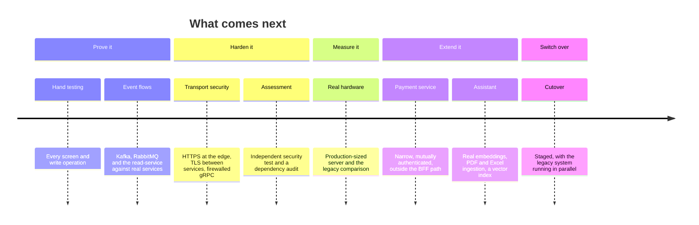

<p align="right"><sub><a href="#top">Back to top</a></sub></p>

---

## Contributing

This is an internal repository; contact the engineering team for access.

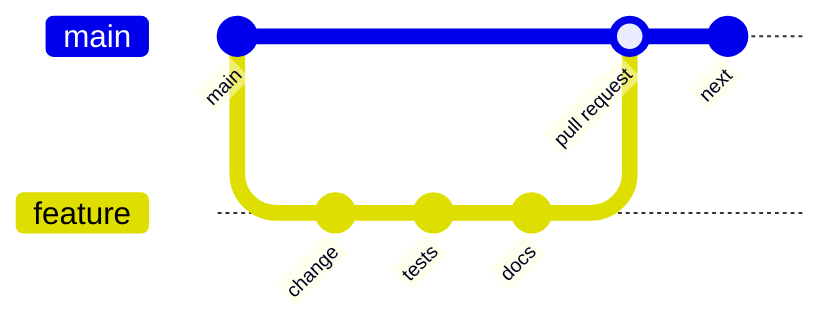

1. Branch from `main` for each feature or fix. Do not push to `main` directly.
2. Keep each pull request focused, and describe what changed, why, and how it was tested.
3. Before opening a pull request, run the suites for the code you touched (see [Testing](#testing)) and, for changes that affect the running system, `qa/smoke.sh` against a local stack.
4. If you add a BFF API endpoint, add its page or card in `services/bff/config/portal_modules.php`. The coverage test enforces this.
5. If you change request signing, change it everywhere together: the BFF (`GatewaySeal.php`), the Spring services (`GatewaySeal.java`) and the Django services (`config/gateway.py`).
6. Database migrations are versioned and are never edited after they have been merged.
7. Update the relevant document in `docs/` when behaviour changes, and add or amend an ADR when an architectural decision changes.

> [!CAUTION]
> Do not commit secrets. Development values belong in `local.env`. Anything sensitive belongs in the untracked `local.env.private` or in your secret manager.

<p align="right"><sub><a href="#top">Back to top</a></sub></p>

---

## License

Proprietary. All rights reserved. This software is the confidential property of Ensuretech. Unauthorized copying, distribution or use is prohibited. Third-party components remain under their own licenses, listed [above](#software-used-and-its-documentation).

<br/>

<div align="center">

<sub>Ensuretech &middot; group health insurance onboarding infrastructure</sub><br/>
<sub><a href="https://github.com/EnsuretechInsuranceBrokers/Ensuretech">Repository</a> &middot; <a href="https://ensuretechinsurancebrokers.github.io/Ensuretech/">Project site</a> &middot; <a href="#top">Back to top</a></sub>

</div>
